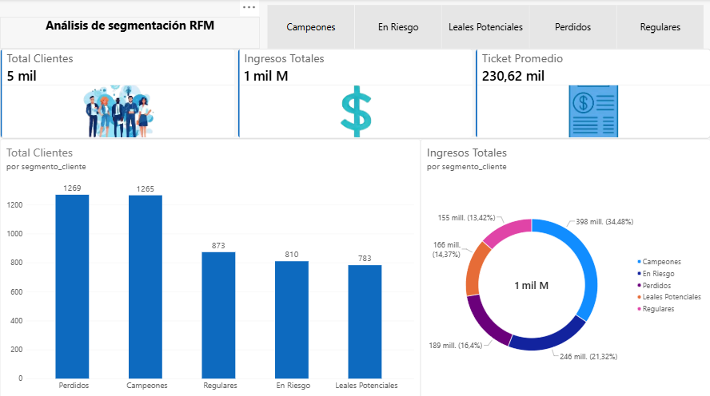

# Análisis de Segmentación de Clientes (Modelo RFM)

## Resumen del Proyecto
Este proyecto aplica la metodología analítica RFM (Recencia, Frecuencia y Valor Monetario) para evaluar el comportamiento de compra de la base de clientes. El objetivo principal es clasificar a los usuarios en distintos segmentos estratégicos para optimizar las campañas de retención, reactivación y fidelización.

## Herramientas Utilizadas
- **Procesamiento de Datos:** Python (librería Pandas).
- **Modelado y Visualización:** Power BI.
- **Lenguaje de Fórmulas:** DAX (para creación de medidas de Recencia, Frecuencia, Ticket Promedio e Ingresos Totales).

## Metodología de Segmentación
Los clientes fueron evaluados mediante un sistema de puntuación y clasificados en 5 segmentos clave:
1. **Campeones:** Clientes recientes, que compran a menudo y gastan mucho.
2. **Leales Potenciales:** Clientes recientes con un nivel de gasto y frecuencia por encima del promedio.
3. **Regulares:** Compradores con recencia, frecuencia y ticket promedio estándar.
4. **En Riesgo:** Clientes que solían comprar frecuentemente y con alto valor, pero llevan mucho tiempo sin transaccionar.
5. **Perdidos:** Clientes con la recencia más baja, compras esporádicas y bajo valor monetario.

## Hallazgos Clave (Insights)
- El segmento "Campeones" representa el grupo más rentable del negocio, generando el 34,48% de los ingresos totales, lo que confirma la necesidad de mantener estrategias de fidelización exclusivas.
- Los clientes "En Riesgo" y "Perdidos" concentran un volumen significativo de los ingresos (21,32% y 16,4% respectivamente), lo que representa una oportunidad inmediata para implementar campañas dirigidas de reactivación.
- Los "Leales Potenciales" aportan el 14,37% de los ingresos, consolidándose como un segmento con alto margen de crecimiento si se aplican tácticas de venta cruzada (cross-selling) o incentivos de compra frecuente.

## Visualización del Dashboard

 

## Cómo explorar este proyecto
1. Clona este repositorio o descarga los archivos directamente.
2. Encuentra los datasets originales y procesados en la carpeta `/data`, y el código fuente en `/scripts`.
3. Abre el archivo `Analisis_Segmentacion_RFM.pbix` ubicado en la carpeta `/dashboard` utilizando Power BI Desktop para interactuar con las visualizaciones y los filtros.
